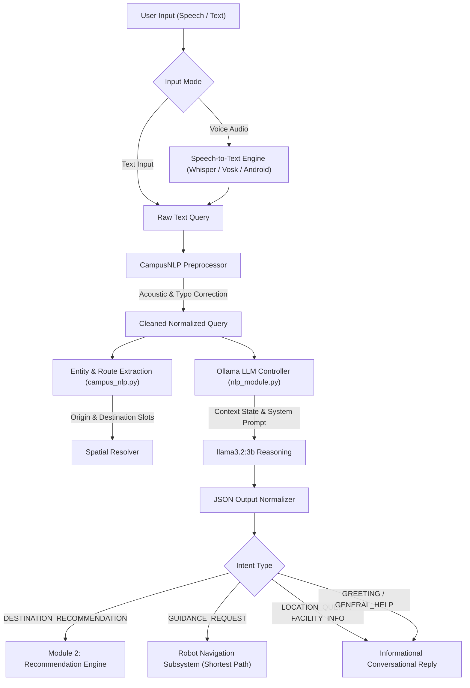

# Conversational AI & NLP Subsystem (Module 1 & 2)

**Universiti Teknikal Malaysia Melaka (UTeM)**  
*Faculty of Information and Communication Technology (FTMK)*  
*Project: AI-Powered Intelligent Guidance and Navigation Application Using an Autonomous Service Robot*

---

## 1. Overview

The `AI/` directory contains the core artificial intelligence, natural language processing, entity resolution, and recommendation algorithms powering the autonomous campus guidance robot. 

This subsystem is responsible for:
1. **Conversational Understanding**: Parsing spoken or typed natural language queries from students, lecturers, staff, and visitors.
2. **Intent Recognition & Slot Filling**: Classifying user queries into 7 distinct intents and extracting spatial entities (destination, category, building).
3. **Phonetic Speech & Typo Correction**: Repairing speech-to-text acoustic mishearings, dialect slips, homophones, and spelling typos before processing.
4. **Context & Anaphora Resolution**: Maintaining multi-turn conversation memory (resolving pronouns such as *"it"*, *"there"*, *"that room"*).
5. **Intelligent Destination Recommendation**: Scoring and suggesting destinations based on user needs, category tags, and proximity.
6. **Downstream Handoff**: Producing structured JSON payloads for robot navigation and path planning.

---

## 2. Directory Structure

```
AI/
├── __init__.py                     # Package initializer exporting NLPModule and CampusNLP
├── campus_nlp.py                   # High-performance deterministic NLP & phonetic correction engine
├── nlp_module.py                   # Conversational AI LLM Controller (Ollama / llama3.2:3b)
├── main.py                         # Interactive CLI test harness for Module 1
├── NLP_Desc.md                     # Module 1 formal AI/NLP technical specification
├── README.md                       # This comprehensive documentation guide
└── recommendation/                 # Module 2: AI Recommendation Subsystem
    ├── __init__.py                 # Package initializer exporting RecommendationEngine
    ├── knowledge_base.py           # Campus destination data loader & repository
    ├── recommendation_engine.py    # Weighted multi-criteria recommendation scoring algorithm
    ├── README.md                   # Module 2 specific documentation & guide
    └── tests/
        ├── __init__.py             # Test package initializer
        └── test_recommendation.py  # Unit test suite for recommendation scenarios
```

---

## 3. Comprehensive File & Folder Guide

### 📄 `AI/campus_nlp.py` (Campus NLP Engine)
*Deterministic, high-performance rule-based NLP and entity resolution module.*

- **Typo & Spelling Normalization**: Corrects common student typos and navigational slang (e.g., `'short part'` $\rightarrow$ `'short path'`, `'toliet'` $\rightarrow$ `'toilet'`, `'libary'` $\rightarrow$ `'library'`).
- **Speech-To-Text (STT) Phonetic Repair**: Fixes acoustic slips and homophones generated by speech recognizers:
  - `"billy kulia to"` / `"billy kulia two"` $\rightarrow$ `"bilik kuliah 2"`
  - `"where did europe"` / `"where do you and europe"` $\rightarrow$ `"where is dewan kuliah"`
  - `"the one cool yeah"` $\rightarrow$ `"dewan kuliah"`
  - `"die k"` / `"day k"` $\rightarrow$ `"dk"`
  - `"program that one"` $\rightarrow$ `"programming lab 1"`
  - `"ai lab tour"` $\rightarrow$ `"ai lab 4"`
  - `"see act"` / `"c act"` $\rightarrow$ `"c-act"`
- **Abbreviation & Contraction Expansion**: Expands shorthand campus codes (`'bk 1'` $\rightarrow$ `'lecture room 1'`, `'se lab 2'` $\rightarrow$ `'software engineering lab 2'`).
- **Longest-Alias-First Entity Resolution**: Matches destination names by prioritizing the longest matching alias first, preventing substring collision bugs (e.g., ensuring `"Network Lab 1"` is not misidentified as `"Network Lab"`).
- **Origin-to-Destination Slot Extraction**: Parses complex multi-location queries (e.g., *"How do I get to AI Lab 2 after my class at Bilik Kuliah 3?"* or *"From Main Entrance to C-ACT"*).
- **Navigation Intent Detection**: Detects imperative navigation commands (*"bring me"*, *"guide me"*, *"show me the way"*, *"tunjukkan jalan"*).

---

### 📄 `AI/nlp_module.py` (Conversational AI LLM Controller)
*LLM-driven dialogue manager powered by Ollama (`llama3.2:3b`).*

- **System Prompt Specification**: Embeds detailed spatial knowledge of FTMK across Blocks A, B, C, D, E and Levels 1 to 4.
- **Strict University Identity**: Strictly enforces the identity of **Universiti Teknikal Malaysia Melaka (UTeM)** in Durian Tunggal / Hang Tuah Jaya, Melaka (rejecting any hallucination of UTAR or other institutions).
- **FTMK Operational Boundaries**:
  - **No Library Inside FTMK**: Clearly informs users that the library (*Perpustakaan Laman Hikmah*) is on the central campus, and directs them to FTMK study areas (C-ACT, Discussion Rooms, Common Room).
  - **Food & Snacks**: FTMK has no cafeteria; food vendors operate at the **Main Entrance / Lobby (Block A, Level 1)** selling Nasi Lemak, Karipap, Pau, and drinks.
  - **Stairs Only**: FTMK has no lifts or escalators for regular navigation; always instructs users to take the stairs.
  - **Dewan Kuliah (DK) Boundary**: Explains that Dewan Kuliah halls (DK 1–16) are located outside FTMK at *Kompleks Dewan Kuliah* next to Dewan Canselor.
- **Intent Classification**: Evaluates input against 7 canonical intents.
- **Multi-Turn Context State**: Maintains an active dialogue state (`last_destination`, `last_category`, `last_building`) allowing natural follow-ups (*"When does it open?"*, *"Which block is it in?"*).
- **Robust JSON Output Parser**: Parses LLM responses into strict JSON format with regex fallback extraction in case of malformed tokens.

---

### 📄 `AI/main.py` (Interactive CLI Test Harness)
*Interactive terminal interface for testing Module 1 independently of Android or backend services.*

- Allows developers and researchers to interactively converse with the AI guidance assistant.
- Displays full structured JSON output: `intent`, `entities`, `reply`, and `destination`.
- Inspects internal context memory (`_context`) and downstream handoff payloads (`_handoff`).
- Measures response generation latency in seconds.

---

### 📄 `AI/NLP_Desc.md` (Module 1 Formal Specification)
*The technical specification and grading rubric document for Module 1.*

- Defines the 7 standard intents and their exact definitions.
- Specifies entity extraction rules for `destination`, `category`, and `building`.
- Outlines context reuse, anaphora resolution, and conversational boundaries.
- Provides the complete target JSON schema.

---

### 📁 `AI/recommendation/` (Module 2 Subsystem)
*Campus destination recommendation engine.*

- **`knowledge_base.py`**: Loads location records from JSON, indexes categories, tags, operating hours, and floor levels.
- **`recommendation_engine.py`**: Implements a weighted multi-criteria scoring algorithm:
  - Exact & partial keyword matching on destination names and aliases.
  - Category relevance (e.g., `'food'`, `'study'`, `'lab'`, `'printing'`).
  - Spatial proximity bonus if the user's current location or starting block is provided.
  - Returns ranked candidates with a top match and confidence score.
- **`tests/test_recommendation.py`**: Automated unit test suite covering 10 distinct recommendation scenarios (food, study areas, printing, specific labs, invalid queries, etc.).

---

## 4. End-to-End Processing Architecture



---

## 5. The 7 Canonical Intents

| Intent | Description | Sample User Query |
| :--- | :--- | :--- |
| `GREETING` | Initiating or opening conversation | *"Hello"*, *"Good morning"*, *"Hi assistant"* |
| `LOCATION_QUERY` | Inquiring where a room or facility is located | *"Where is Makmal AI 2?"*, *"Location of BK 1"* |
| `GUIDANCE_REQUEST` | Requesting navigation or walking directions | *"Bring me to C-ACT"*, *"Short path from Main Entrance to AI Lab 1"* |
| `FACILITY_INFO` | Details regarding amenities or surrounding facilities | *"What facilities are in Block B?"*, *"What is near Bilik Kuliah 2?"* |
| `OPENING_HOURS` | Operational hours and schedules | *"What time does C-ACT close?"*, *"When is the office open?"* |
| `GENERAL_HELP` | Help requests, small talk, general questions | *"How can you help me?"*, *"Tell me a joke"*, *"What is 25 * 4?"* |
| `DESTINATION_RECOMMENDATION`| Asking for recommendations based on need | *"Where can I print my notes?"*, *"I am hungry, where can I get snacks?"* |

---

## 6. How to Run and Test

### 1. Run the Interactive Module 1 CLI
Make sure your Python environment has Ollama running (`ollama serve` and `ollama run llama3.2:3b`):
```bash
# From workspace root
python -m AI.main
```

### 2. Run the Module 2 Recommendation Unit Tests
```bash
# Execute the recommendation engine test suite
python -m AI.recommendation.tests.test_recommendation
```

### 3. Test Campus NLP Phonetic Corrections in Python
```python
from AI.campus_nlp import CampusNLP

raw_voice_text = "where did europe and bring me to see act"
cleaned = CampusNLP.correct_speech_transcript(raw_voice_text)
print(cleaned)
# Output: "where is dewan kuliah and bring me to c-act"
```

---

## 7. Integration with Robot & Android App

- **Android App (`aiguidance_bot`)**: Captures user speech word-by-word with `SpeechRecognizer`, pre-corrects terms locally using `CampusSpeechCorrector.kt`, and communicates with the backend via `POST /api/v1/assistant/chat`.
- **Backend API (`module_1_back_end`)**: Wraps `nlp_module.py` and `campus_nlp.py` into a high-performance async FastAPI service with full session management, audio transcription endpoints (`/chat/voice`, `/stt`), and Dijkstra shortest-path navigation handoffs.
